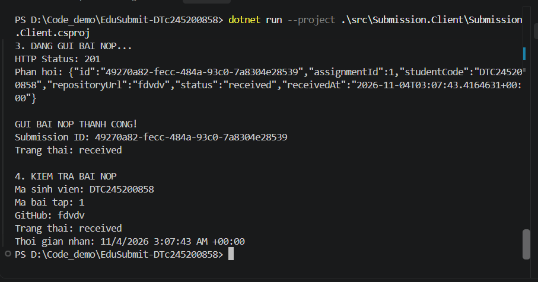
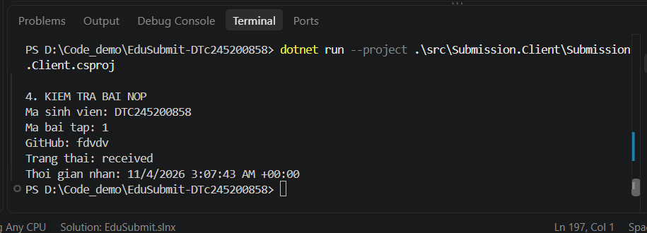

# BÀI 1 - TỔNG QUAN HỆ THỐNG VÀ CÁC MÔ HÌNH TRAO ĐỔI THÔNG ĐIỆP (MEP)
Họ tên: Dương Thị Khánh Linh  
MSSV: DTC245200858  
Lớp: CNTT K23E

## 1. Mục tiêu

## 2. MepDemo (Bước 7)

(1) Ở MEP 3, mỗi bài nộp sub-x được mấy worker xử lý?
Mỗi bài nộp sub-x thường được một worker xử lý trong mô hình Queue-based. Một thông điệp trong hàng đợi thường được một worker nhận xử lý, tránh nhiều worker cùng xử lý một bài nộp.
(2) Ở MEP 4, một sự kiện được gửi tới mấy dịch vụ?
Trong mô hình Publish-Subscribe, một sự kiện có thể được gửi tới nhiều dịch vụ đã đăng ký nhận sự kiện đó.
(3) Viết 1 câu mô tả cho mỗi MEP
1. Request-Response: Client gửi yêu cầu đến Server và chờ nhận phản hồi.
2. One-way: Bên gửi gửi thông điệp mà không cần chờ phản hồi trực tiếp.
3. Queue-based: Thông điệp được đưa vào hàng đợi và được worker lấy ra xử lý.
4. Publish-Subscribe: Một sự kiện được phát tới tất cả dịch vụ đăng ký nhận sự kiện đó.
5. Streaming/Push: Dữ liệu được gửi liên tục hoặc được Server chủ động đẩy đến Client.

## 3. BasicWebApi (Bước 8)
- Ảnh chụp REST Client: 200, 201, 400

**Câu 1. Hai dòng `builder.Services.AddSingleton...` và `var app = builder.Build();` – dòng nào phải đứng trước? Vì sao?**

Dòng `builder.Services.AddSingleton...` phải đứng trước `var app = builder.Build();` vì cần đăng ký dịch vụ trước khi xây dựng ứng dụng. Sau khi gọi `builder.Build()`, ứng dụng đã được tạo từ các dịch vụ đã đăng ký.

**Câu 2. Trong `/hello/{name}?language=en`, tham số `name` lấy từ đâu, `language` lấy từ đâu?**

- `name` lấy từ phần đường dẫn URL (route parameter). Ví dụ, `/hello/An?language=en` thì `name = "An"`.
- `language` lấy từ chuỗi truy vấn URL (query parameter) sau dấu `?`. Ví dụ, `?language=en` thì `language = "en"`.

**Câu 3. Vì sao POST hợp lệ trả `Results.Created (201)` chứ không phải `Results.Ok (200)`?**

`Results.Created` trả mã HTTP 201 Created, thể hiện rằng tài nguyên mới đã được tạo thành công. Trong khi đó, `Results.Ok` trả mã HTTP 200 OK, thường dùng khi yêu cầu được xử lý thành công nhưng không nhất thiết tạo ra tài nguyên mới. Vì vậy, khi POST tạo mới thành công, dùng `Results.Created` phù hợp hơn với ý nghĩa của HTTP.

## 4. MiniDistributedSystem (Bước 9)
- Ảnh chụp 2 terminal API + Client

- Trả lời 3 câu hỏi
Câu 1. Client gọi những endpoint nào của API? Mỗi lần gọi là một cặp request–response gồm method, URL, mã trạng thái gì?

Client sử dụng HTTP để giao tiếp với API thông qua các endpoint. Dựa trên chức năng của dự án, các request chính gồm:

Method

URL

Mục đích

Mã trạng thái thành công

GET

/api/assignments

Lấy danh sách bài tập

200 OK

POST

/api/submissions

Gửi thông tin bài nộp

201 Created

GET

/api/submissions/{id}

Lấy thông tin bài nộp theo ID

200 OK

Trong đó:

GET /api/assignments: Client gửi yêu cầu lấy danh sách bài tập và API trả về dữ liệu JSON.

POST /api/submissions: Client gửi thông tin bài nộp gồm mã bài tập, mã sinh viên và URL repository. Nếu dữ liệu hợp lệ, API tạo bản ghi bài nộp và trả về mã trạng thái 201 Created.

GET /api/submissions/{id}: Client sử dụng ID nhận được sau khi gửi bài để truy vấn thông tin bài nộp. Nếu tìm thấy, API trả về 200 OK.

Mỗi lần gọi API tạo thành một cặp request–response: Client gửi request, API xử lý và trả response gồm mã trạng thái cùng dữ liệu phản hồi.

Câu 2. Client có tham chiếu (dùng chung) code của API không? Hai bên "thống nhất" với nhau bằng gì?

Client và API là hai thành phần riêng biệt. Client không cần tham chiếu trực tiếp đến code xử lý bên trong API. Client giao tiếp với API thông qua giao thức HTTP và trao đổi dữ liệu theo định dạng JSON.

Hai bên thống nhất với nhau thông qua API contract, bao gồm:

Địa chỉ URL và các endpoint.

Phương thức HTTP như GET và POST.

Cấu trúc dữ liệu JSON gửi đi và nhận về.

Tên các trường dữ liệu như assignmentId, studentCode, repositoryUrl, id và status.

Ý nghĩa của các mã trạng thái HTTP như 200 OK, 201 Created, 400 Bad Request và 404 Not Found.

Nhờ đó, Client và API có thể được phát triển riêng biệt nhưng vẫn giao tiếp được với nhau khi tuân thủ đúng hợp đồng API.

Câu 3. Vì sao địa chỉ API được truyền qua tham số thay vì viết cứng trong code?

Địa chỉ API được truyền qua tham số để chương trình linh hoạt hơn, tránh phụ thuộc vào một địa chỉ cố định.

Ví dụ, Client có thể nhận địa chỉ API từ tham số dòng lệnh hoặc sử dụng địa chỉ mặc định nếu không truyền tham số. Cách làm này có các lợi ích:

Dễ dàng thay đổi địa chỉ API mà không cần sửa code.

Có thể chạy Client với API ở các môi trường khác nhau như máy cá nhân, máy chủ kiểm thử hoặc máy chủ triển khai.

Thuận tiện khi kiểm thử và gỡ lỗi.

Giảm sự phụ thuộc giữa Client và môi trường chạy API.

Trong dự án, địa chỉ API mặc định ban đầu là http://localhost:5000. Khi API chạy ở cổng 5081, Client cần được cấu hình sử dụng http://localhost:5081 hoặc truyền địa chỉ mới qua tham số dòng lệnh. Nhờ đó, cùng một chương trình Client có thể kết nối đến các địa chỉ API khác nhau mà không phải thay đổi logic xử lý.

5. Thí nghiệm lỗi (Bước 10)

#

Dự đoán

Thực tế

Đúng/Sai

Giải thích

1

Nếu API không chạy, Client vẫn có thể lấy danh sách bài tập bình thường.

Client báo lỗi kết nối đến API tại localhost.

Sai

Client cần API đang hoạt động để gửi request và nhận response. Khi API không chạy, kết nối bị từ chối.

2

Nếu Client sử dụng sai cổng API, Client vẫn kết nối được.

Client báo lỗi kết nối khi sử dụng localhost:5000, trong khi API chạy ở localhost:5081.

Sai

Địa chỉ và cổng của Client phải khớp với địa chỉ mà API đang lắng nghe.

3

Nếu gửi yêu cầu tạo bài nộp với dữ liệu hợp lệ, API sẽ tạo bài nộp thành công.

API trả về HTTP 201 Created và thông tin bài nộp gồm ID, mã bài tập, mã sinh viên, URL repository và trạng thái.

Đúng

HTTP 201 cho biết tài nguyên mới đã được tạo thành công.

4

Nếu gửi dữ liệu không hợp lệ, API sẽ luôn tạo bài nộp thành công.

API có thể trả về HTTP 400 Bad Request khi dữ liệu không hợp lệ.

Sai

API kiểm tra dữ liệu đầu vào và từ chối yêu cầu không đáp ứng điều kiện hợp lệ.

5

Nếu truy vấn một ID bài nộp không tồn tại, API vẫn trả về thông tin bài nộp.

Theo thiết kế endpoint, API có thể trả về HTTP 404 Not Found nếu không tìm thấy bài nộp.

Sai

ID được dùng để xác định tài nguyên. Nếu không tồn tại, API không thể trả về thông tin bài nộp tương ứng.

Nhận xét

Qua thí nghiệm, em nhận thấy Client và API cần sử dụng đúng địa chỉ, cổng và cấu trúc dữ liệu đã thống nhất. Khi xảy ra lỗi kết nối hoặc dữ liệu đầu vào không hợp lệ, cần kiểm tra log, địa chỉ API và phản hồi HTTP để xác định nguyên nhân. Các mã trạng thái HTTP giúp phân biệt yêu cầu thành công với yêu cầu bị từ chối hoặc tài nguyên không tồn tại.

## 6. Kết quả kiểm thử

6.1. Phần tham khảo code mẫu

Trong quá trình xây dựng dự án EduSubmit, em tham khảo code mẫu để hiểu cách xây dựng ứng dụng ASP.NET Core, khai báo endpoint, sử dụng HTTP Client và trao đổi dữ liệu JSON giữa Client và API.

Các kiến thức tham khảo gồm:

Cách khởi tạo ứng dụng ASP.NET Core bằng WebApplication.CreateBuilder(args) và builder.Build().

Cách khai báo endpoint GET và POST.

Cách nhận dữ liệu JSON từ request body và trả về response.

Cách sử dụng HttpClient để gửi yêu cầu HTTP từ Client đến API.

Cách sử dụng mã trạng thái HTTP để biểu thị kết quả xử lý.

Phần em tự triển khai và điều chỉnh trong dự án là các endpoint phục vụ bài tập, cấu trúc dữ liệu bài nộp, kiểm tra dữ liệu đầu vào, lưu bài nộp trong bộ nhớ và luồng Client gửi bài rồi truy vấn kết quả theo ID.
6.3 Luồng thông điệp

Lấy danh sách bài tập

Client --(HTTP GET /api/assignments)--> API: request-response.

API trả về HTTP 200 OK cùng danh sách bài tập ở định dạng JSON.

Gửi bài nộp

Client --(HTTP POST /api/submissions)--> API: request-response.

Client gửi dữ liệu JSON gồm assignmentId, studentCode và repositoryUrl. API kiểm tra dữ liệu, tạo bài nộp và trả về HTTP 201 Created cùng thông tin bài nộp, bao gồm id và status.

Truy vấn bài nộp theo ID

Client --(HTTP GET /api/submissions/{id})--> API: request-response.

Client sử dụng ID nhận được từ bước gửi bài để truy vấn thông tin. API trả về HTTP 200 OK nếu tìm thấy bài nộp.

7. Khó khăn gặp phải và cách giải quyết

Trong quá trình thực hiện bài thực hành, em gặp một số khó khăn khi chạy chương trình, cấu hình địa chỉ API và kiểm thử chức năng. Cụ thể như sau:

STT

Khó khăn gặp phải

Nguyên nhân

Cách giải quyết

1

Lỗi Couldn't find a project to run khi chạy lệnh dotnet run.

Thư mục hiện tại không chứa file .csproj ngay bên trong nên .NET không xác định được project cần chạy.

Sử dụng tham số --project để chỉ rõ đường dẫn đến file project, ví dụ src/Submission.Api/Submission.Api.csproj.

2

Client không kết nối được với API, xuất hiện lỗi actively refused it (localhost:5000).

Client sử dụng cổng 5000 trong khi API đang chạy tại cổng 5081.

Kiểm tra cấu hình trong Program.cs của Client, thay đổi địa chỉ API thành http://localhost:5081 hoặc truyền địa chỉ API qua tham số dòng lệnh.

3

Chưa biết cách kiểm tra các mã trạng thái HTTP 200, 201 và 400.

Chưa quen với cách gửi request và đọc response khi kiểm thử API.

Sử dụng trình duyệt để kiểm tra các endpoint GET và sử dụng REST Client trong VS Code để gửi các request GET, POST, sau đó kiểm tra mã trạng thái và dữ liệu JSON trả về.

4

Khó xác định API đã chạy thành công hay chưa.

Chưa quen đọc thông báo trong terminal và log của ASP.NET Core.

Quan sát thông báo Now listening on, Application started và các dòng log thể hiện endpoint đã được thực thi, mã trạng thái phản hồi.

5

Chưa hiểu rõ cách Client và API trao đổi dữ liệu.

Client và API là hai chương trình riêng biệt, giao tiếp thông qua HTTP thay vì gọi trực tiếp các hàm của nhau.

Đọc code của Client và API, xác định các endpoint, phương thức HTTP, dữ liệu JSON và mã trạng thái phản hồi. Sau đó mô tả luồng request–response trong nhật ký.

Kết luận

Qua quá trình thực hành, em đã rèn luyện kỹ năng chạy ứng dụng .NET bằng dòng lệnh, xác định đúng project cần chạy, cấu hình địa chỉ API và xử lý lỗi kết nối giữa Client với API. Đồng thời, em hiểu rõ hơn cách giao tiếp giữa hai thành phần thông qua HTTP, cách sử dụng JSON để trao đổi dữ liệu và cách kiểm tra kết quả bằng mã trạng thái HTTP.

Những lỗi gặp phải giúp em hiểu rằng khi một ứng dụng không hoạt động, cần kiểm tra lần lượt thư mục dự án, cấu hình, địa chỉ và cổng kết nối, trạng thái hoạt động của API và nội dung log để xác định nguyên nhân trước khi sửa lỗi.